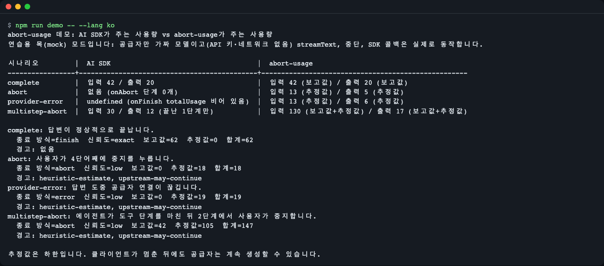
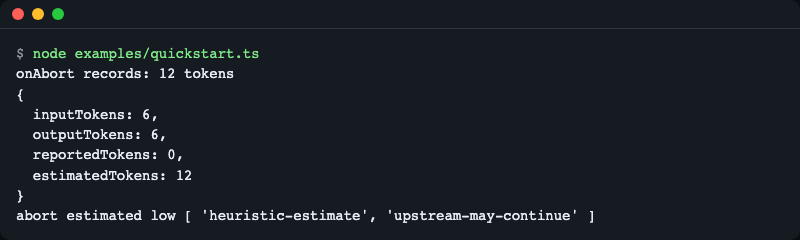
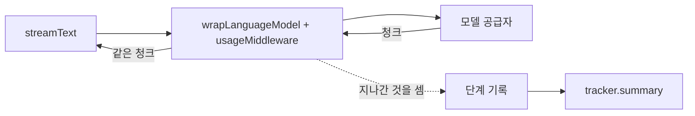
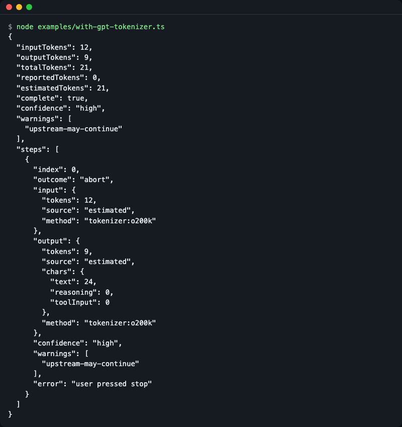
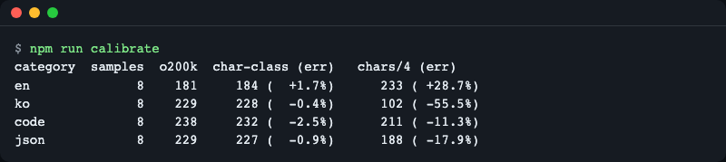

# abort-usage

[English](README.md) | **한국어**

[Vercel AI SDK](https://ai-sdk.dev)(`ai` 7)용 토큰 사용량 미들웨어입니다. `streamText` 호출을 사용자가 중지하거나, 연결이 끊기거나, 오류로 끝나도 입력·출력 토큰 수를 알려 주고, 모든 숫자에 공급자가 **보고한 값(reported)** 인지 이 라이브러리가 **추정한 값(estimated)** 인지 표시합니다. `wrapLanguageModel` 로 붙이고 `tracker.summary()` 를 읽어 과금·한도·비용 대시보드에 쓰면 됩니다.



*데모(연습용 목 모드): 중지되거나 실패한 스트림에서 SDK 는 아무것도 주지 않지만, abort-usage 는 출처가 표시된 숫자를 줍니다.*

## 문제

`streamText` 는 요청이 정상으로 끝날 때만 사용량을 온전히 알려 줍니다. 스트림이 끝나는 네 가지 경우에 SDK 가 주는 값입니다(`ai` 7.0.183 과 목 공급자로 확인, 위 표 참고).

| 종료 방식 | AI SDK 가 주는 것 |
|---|---|
| 정상 완료 | `onFinish` 의 `totalUsage`(공급자가 보낸 숫자) |
| 사용자 중지(`abortSignal`) | `onAbort` 에 *끝난* 단계만 전달. 진행 중이던 단계는 사용량이 없어 합계가 0 |
| 공급자 오류 | `onError` 다음에 `onFinish`, 단 `totalUsage` 값이 `undefined` |
| 다단계 중지 | `onAbort` 에 끝난 단계만 전달(멈춘 단계는 빠짐) |

그래서 `usage.inputTokens ?? 0` 같은 코드는 중지·오류 요청을 0 토큰으로 과금합니다. 공급자는 더 많이 생성하고 청구했을 수 있는데도요. [vercel/ai#7628](https://github.com/vercel/ai/issues/7628) 을 보세요. abort-usage 는 스트림을 지나간 내용을 세어, 빈 자리를 이름표가 붙은 추정값으로 채웁니다.

## 설치

```bash
npm install github:LeeGyeongPil/abort-usage
```

- Node.js 22 이상. `ai` 7(`>=7.0.0 <8`)은 peer 의존성이고, 그 밖의 런타임 의존성은 없습니다.
- clone 해서 데모·예제를 돌리려면 Node 22.18 이상이 필요합니다(Node 가 `.ts` 파일을 바로 실행하는 기능을 씁니다).

```bash
git clone https://github.com/LeeGyeongPil/abort-usage && cd abort-usage
npm install
npm run demo
```

clone 에서 `npm install` 을 하면 `dist/` 도 빌드됩니다(`prepare` 스크립트). GitHub 에서 설치할 때 `prepare` 실행에 관한 npm 경고가 나올 수 있으며, 정상이고 무해합니다.

Node 가 없다면 `brew install node`(macOS) 또는 [nodejs.org](https://nodejs.org/). 최소 리눅스 이미지에는 `git` 과 `ca-certificates` 도 필요합니다.

## 빠르게 시작하기

```ts
import { streamText } from 'ai';
import { createUsageTracker } from 'abort-usage';

const tracker = createUsageTracker();        // 요청마다 tracker 하나
const model = tracker.wrap(yourModel);       // yourModel: AI SDK 7 언어 모델

const record = () => ledger.add(tracker.summary());   // 직접 만든 과금·한도 코드

const result = streamText({
  model, prompt, abortSignal,
  onFinish: record,                          // 정상 완료, 공급자 오류(onError 가 먼저 불림)
  onAbort: record,                           // 사용자 중지
});
```

합계는 `onFinish` 와 `onAbort` **두 곳에서만** 읽으세요. 요청 하나는 둘 중 정확히 하나로 끝납니다([과금](#과금-합계는-한-번만-읽기) 참고).

실행 가능한 전체 파일은 [`examples/quickstart.ts`](examples/quickstart.ts) 입니다(`yourModel` 대신 목 공급자를 써서 API 키가 필요 없습니다). clone 에서 실행합니다.

```bash
node examples/quickstart.ts
```

```text
onAbort records: 12 tokens
{
  inputTokens: 6,
  outputTokens: 6,
  reportedTokens: 0,
  estimatedTokens: 12
}
abort estimated low [ 'heuristic-estimate', 'upstream-may-continue' ]
```



*빠르게 시작하기: 청크 5개를 받은 뒤 중단했는데도 토큰이 집계됩니다. 두 숫자 모두 `estimated`, 신뢰도 `low` 입니다.*

## 과금: 합계는 한 번만 읽기

어느 콜백이 불리는지는 요청이 어떻게 끝나느냐에 따라 다릅니다. `ai` 7.0.183 에서 측정한 값입니다.

| 종료 방식 | 콜백 호출 순서 | `tracker.summary()` 를 읽을 곳 |
|---|---|---|
| 정상 완료 | `onFinish` | `onFinish` |
| 사용자 중지 | `onAbort` | `onAbort` |
| 공급자 오류 | `onError`, 이어서 `onFinish` | `onFinish`(`onError` 에서 읽으면 이중 과금) |
| 다단계 중지 | `onAbort` | `onAbort` |

즉 `onFinish` 와 `onAbort` 로 모든 종료를 정확히 한 번씩 덮습니다. 모델 객체 하나를 여러 요청이 공유한다면 tracker 대신 `usageMiddleware({ onStep })` 을 쓰세요(예제 2). 콜백과 상관없이 끝난 단계마다 한 번 호출됩니다. 이 순서는 SDK 동작이라 다른 `ai` 버전에서는 달라질 수 있고, `npm test` 의 콜백 순서 테스트(`test/finish.test.ts`, `test/abort.test.ts`, `test/error.test.ts`, `test/multistep.test.ts`)가 네 종료 방식 모두를 설치된 버전에서 확인합니다.

## 핵심 개념



1. **단계(step).** 모델 호출 한 번입니다. 일반 답변은 1단계, 도구를 부르고 다시 답하는 에이전트는 2단계입니다.
2. **정확히 한 번 닫힘.** 미들웨어는 청크를 그대로 통과시키고, 다음 중 먼저 일어난 일로 단계를 닫습니다: finish 청크, error 청크, 요청의 `AbortSignal`, 소비자의 스트림 취소, finish 없이 스트림 종료.
3. **보고값 vs 추정값.** 공급자가 사용량을 보내면 `source: 'reported'` 로 그대로 줍니다. 아니면 본 것을 바탕으로 추정합니다: 입력은 프롬프트(와 도구 정의), 출력은 도착한 텍스트·reasoning·도구 인자 델타입니다. 이 숫자에는 `source: 'estimated'`, `method`, `confidence`(`exact`, 토크나이저를 주입하면 `high`, 기본 휴리스틱은 `low`)와 경고 코드가 붙습니다.
4. **합계도 둘을 나눕니다.** `summary()` 에 `reportedTokens` 와 `estimatedTokens` 가 따로 있어 대시보드가 청구액 중 추정이 얼마인지 보여 줄 수 있습니다.

섞인 예(데모의 `multistep-abort` 행): 1단계는 끝나서 공급자가 입력 30 / 출력 12 를 보고했고, 사용자가 2단계를 중지했습니다. 합계 147 토큰 = 보고 42 + 추정 105 입니다.

## API

| 이름 | 하는 일 | 주요 인자 | 반환 |
|---|---|---|---|
| `usageMiddleware(options)` | AI SDK `LanguageModelMiddleware`(`wrapStream`). 여러 요청이 공유해도 됩니다. | 모델 호출마다 한 번 불리는 `onStep(step)`; `estimator`; `warnUpstreamMayContinue`(기본 `true`); `onCallbackError`(기본 `console.warn`) | `LanguageModelMiddleware` |
| `createUsageTracker(options?)` | 요청 하나의 단계를 모으는 도우미. | 위와 같은 옵션, `onStep` 은 선택 | `UsageTracker`: `middleware`, `wrap(model)`, `steps`(끝난 단계), `summary()` |
| `summarize(steps)` | `onStep` 으로 모은 `StepUsage[]` 를 합산. | `StepUsage[]` | `UsageSummary` |
| `charClassEstimator(coefficients?)` | 기본 추정기: 문자군(한글·CJK·단어·공백·기호)별 문자당 토큰 계수. 의존성 없음. | 일부 `CharClassCoefficients` | `TokenEstimator` |
| `tokenizerEstimator(count, name?)` | 직접 고른 토크나이저 함수를 감쌉니다. 결과는 `confidence: 'high'`. | `count(text) => number`, 이름 | `TokenEstimator` |
| `toLanguageModelUsage(usage)` | 요약·단계 하나를 SDK 의 `LanguageModelUsage` 형태로 바꿉니다. 추정값도 그대로 들어갑니다. | `UsageSummary` 또는 `StepUsage` | `LanguageModelUsage` |

타입: `StepUsage`, `UsageSummary`, `StepOutcome`(`finish`, `abort`, `error`, `cancel`, `ended-without-finish`, `open`), `UsageSource`, `Confidence`, `UsageWarning`, `TokenEstimator`, `CharClassCoefficients`, `UsageMiddlewareOptions`, `UsageTracker`, `TrackerOptions`.

`summary()` 는 아직 진행 중인 단계도 `outcome: 'open'` 과 추정값으로 포함하므로, 이벤트 순서 때문에 0 이 나오는 일이 없습니다. 열린 단계가 있으면 `summary().complete` 는 `false` 입니다.

경고 코드(고정 문자열): `upstream-may-continue`, `heuristic-estimate`, `reported-usage-missing`, `non-text-input-not-counted`, `reasoning-not-streamed`.

`onStep` 이 예외를 던져도 스트림은 영향을 받지 않고, 오류는 `onCallbackError` 로 갑니다.

## 사용 예

모든 예제는 목 공급자를 쓰므로 API 키가 필요 없습니다. clone 에서 실행하세요.

**1. 빠르게 시작하기**(`onFinish`·`onAbort` 에서 합계를 읽음) — 위 내용, [`examples/quickstart.ts`](examples/quickstart.ts).

**2. 공유 모델의 모든 단계를 장부에 기록.** 여러 요청이 모델 객체 하나를 공유한다면 `usageMiddleware({ onStep })` 로 단계마다 장부에 씁니다. [`examples/billing.ts`](examples/billing.ts):

```bash
node examples/billing.ts
```

```text
[ 'abort: 6 in (estimated) / 3 out (estimated)' ]
{
  inputTokens: 6,
  inputTokenDetails: {
    noCacheTokens: undefined,
    cacheReadTokens: undefined,
    cacheWriteTokens: undefined
  },
  outputTokens: 3,
  outputTokenDetails: { textTokens: undefined, reasoningTokens: undefined },
  totalTokens: 9
}
```

`toLanguageModelUsage()` 는 SDK 의 사용량 형태를 주므로 원하는 비용 계산 도구에 넘기면 됩니다. 추정값을 청구하면 안 되는 경우에는 먼저 `summary.estimatedTokens` 를 확인하세요.

**3. 실제 토크나이저로 신뢰도 높이기.** [`examples/with-gpt-tokenizer.ts`](examples/with-gpt-tokenizer.ts) 는 [`gpt-tokenizer`](https://www.npmjs.com/package/gpt-tokenizer)(`o200k_base`)를 `tokenizerEstimator((text) => encode(text).length, 'o200k')` 로 주입합니다.

`gpt-tokenizer` 는 dev 의존성이라 clone 에서 `npm install` 하면 설치됩니다(내 프로젝트에서는 `npm install gpt-tokenizer`). 예제는 `../src` 를 import 하므로 clone 에서 실행하세요.

```bash
node examples/with-gpt-tokenizer.ts
```

기록에 `"method": "tokenizer:o200k"`, `"confidence": "high"` 가 찍힙니다. 단계 기록(`source`, `method`, `confidence`, `warnings`, 받은 글자 수)은 이렇게 생겼습니다.



*요약 하나: 모든 숫자에 출처·방법·경고가 붙습니다.*

**4. 데모.** `npm run demo` 는 네 가지 종료(완료·사용자 중지·공급자 오류·다단계 중지)를 실행해 맨 위의 비교표를 출력합니다. `npm run demo -- --json` 은 기록을, `--lang en|ko` 는 언어를 바꿉니다(우선순위: `--lang`, `ABORT_USAGE_LANG`, `LC_ALL`, `LC_MESSAGES`, `LANG` 순이며, 한국어가 아니면 영어).

데모는 연습용 목(mock) 모드입니다. 공급자만 가짜 모델이고 `streamText`, `AbortController`, SDK 콜백은 실제로 동작합니다. 실제 공급자에서는 시간과 숫자가 다를 수 있습니다.

## 추정은 얼마나 정확한가

과금에 쓰기 전에 꼭 읽으세요.

- 추정값은 **하한**입니다. 클라이언트가 멈춘 뒤에도 공급자는 계속 생성하고 청구할 수 있습니다. 정상 종료가 아닌 모든 단계에 `upstream-may-continue` 가 붙는 이유입니다.
- 기본 추정기는 문자군 휴리스틱입니다. 계수는 직접 쓴 표본 32개(영어·한국어·코드·JSON 각 8개)를 `o200k_base` 로 센 값에 맞춰 구했습니다. 그래서 아래 표는 **표본 내 적합**이라 실제 오차보다 좋아 보입니다. 표본이 작고 비라틴 문자는 한국어뿐입니다. 비슷한 글에서 대략 ±25% 정도를 예상하고, 표본과 다른 글은 더 벗어날 수 있습니다.
- **한자·가나(CJK)용 계수(0.9)는 표본이 없어 검증되지 않았습니다.** 중국어·일본어를 다룬다면 토크나이저를 주입하세요.
- 토크나이저는 공급자마다 다릅니다. `o200k_base` 는 OpenAI 인코딩이라 다른 공급자는 같은 글을 다르게 셉니다.
- 프롬프트의 이미지·파일은 세지 않습니다(`non-text-input-not-counted`). 공급자가 스트리밍하지 않는 reasoning 도 셀 수 없습니다.
- 입력은 프롬프트를 텍스트로 직렬화해 추정하므로 공급자의 숨은 채팅 템플릿 토큰까지 정확히 반영하지는 않습니다.

```bash
npm run calibrate
```

```text
category  samples  o200k  char-class (err)   chars/4 (err)
en              8    181     184 (  +1.7%)      233 ( +28.7%)
ko              8    229     228 (  -0.4%)      102 ( -55.5%)
code            8    238     232 (  -2.5%)      211 ( -11.3%)
json            8    229     227 (  -0.9%)      188 ( -17.9%)
```



*기본 추정기와 단순 chars/4 규칙의 오차(o200k_base 기준, 적합에 쓴 표본 자체에서 잰 값).*

## 한계

- `streamText` 만 다룹니다. `generateText`(`wrapGenerate`)는 아직 지원하지 않습니다.
- `ai` 7(미들웨어 규격 `v4`)용입니다. `ai` 6 에서는 시험하지 않았습니다.
- 소비자가 `abortSignal` 없이 그냥 읽기를 멈추면, 그 취소가 미들웨어까지 전달되는지는 SDK 에 달려 있습니다. 전달되지 않으면 `summary()` 에서 단계가 `open` 으로 남습니다. `streamText` 에 `abortSignal` 을 넘기세요.
- 스트림이 끝나기 전에 오는 공급자 사용량(예: 초기 입력 토큰 수)은 아직 읽지 않으므로, 중단된 단계의 입력은 항상 `estimated` 입니다.
- 요청마다 tracker 하나를 쓰세요. 여러 요청에 재사용하면 합계가 섞입니다.

## 언제 쓰나

- 이럴 때: 사용자별 토큰을 과금·제한·집계하는데 숫자를 `onFinish` 에서 받아서, 중지·실패한 요청이 0 으로 보일 때.
- 이럴 땐 다른 도구: 공급자 청구서와 정확히 맞는 값이 필요하면 공급자의 사용량 대시보드·API 를 보세요. 요청을 보내기 전에 토큰을 세려면 [gpt-tokenizer](https://www.npmjs.com/package/gpt-tokenizer) 같은 토크나이저를, 이미 아는 사용량을 금액으로만 바꾸려면 [tokenlens](https://www.npmjs.com/package/tokenlens) 같은 가격 라이브러리를 쓰세요.

## 문제 해결

| 증상 | 원인 | 해결 |
|---|---|---|
| `onAbort` 안의 `summary()` 에서 `outcome: 'open'` 으로 보임 | 쓰는 `ai` 버전의 이벤트 순서가 다름 | 숫자는 여전히 추정값입니다. 스트림이 끝난 뒤 읽으세요. 이슈에 `ai` 버전을 남겨 주세요. |
| 중지 뒤 출력이 아주 작음 | 스트림이 일찍 끊겨 청크가 몇 개만 도착함 | 정상입니다. 받은 텍스트만 셉니다. |
| `node examples/quickstart.ts` 가 시작되지 않음 | Node 22.18 미만은 `.ts` 를 바로 실행하지 못함 | Node 를 올리세요. 라이브러리 자체는 Node 22 에서 동작합니다. |
| 예제가 `abort-usage` 를 import 하지 못함 | `dist/` 가 빌드되지 않음 | `npm install`(`dist/` 를 빌드함) 또는 `npm run build` 를 실행하세요. |
| 합계에 두 요청이 섞임 | tracker 하나를 여러 요청에 사용 | 요청마다 tracker 를 만들거나 `usageMiddleware({ onStep })` 를 쓰세요. |

## 버전·호환성

- [유의적 버전(SemVer)](https://semver.org/lang/ko/)을 따릅니다. 0.x 동안은 마이너 버전에서 API 가 바뀔 수 있고, 바뀌면 [CHANGELOG.md](CHANGELOG.md)에 적습니다.
- 로컬에서 `ai` 7.0.183, TypeScript 7.0.2, Node 26 으로 확인했습니다. CI 워크플로는 Node 22.18·24 로 돌며, 공개 후 레포의 Actions 탭에서 결과를 볼 수 있습니다.

## 개발

```bash
npm install
npm test          # 타입 검사 + 테스트 32개, API 키 불필요
npm run build
```

## 더 알아보기

- AI SDK, 스트림 중지: <https://ai-sdk.dev/docs/advanced/stopping-streams> (2026-11-27 확인)
- 이 라이브러리의 배경이 된 요청, 중단 시 사용량 누락: <https://github.com/vercel/ai/issues/7628> (2026-11-27 확인)
- stop 이 공급자까지 멈추지 않을 수 있는 이유: <https://ably.com/vercel/why-vercel-ai-sdk-stop-doesnt-cancel-the-stream> (2026-11-27 확인)

## 라이선스

MIT.
