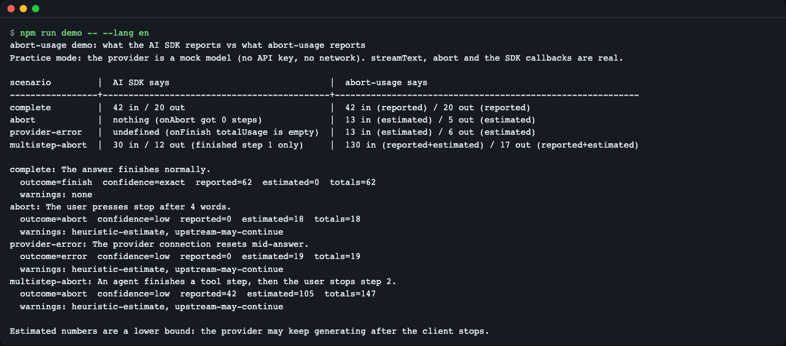
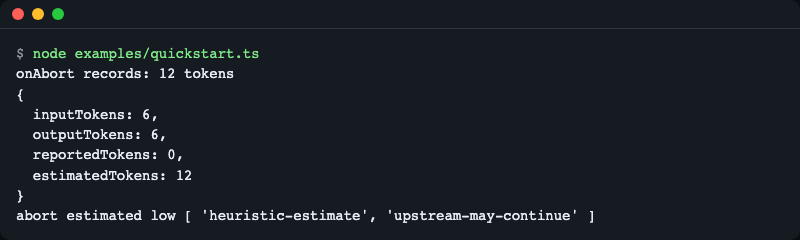
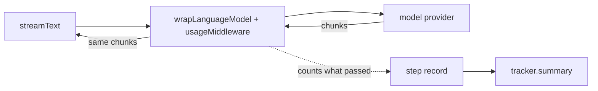
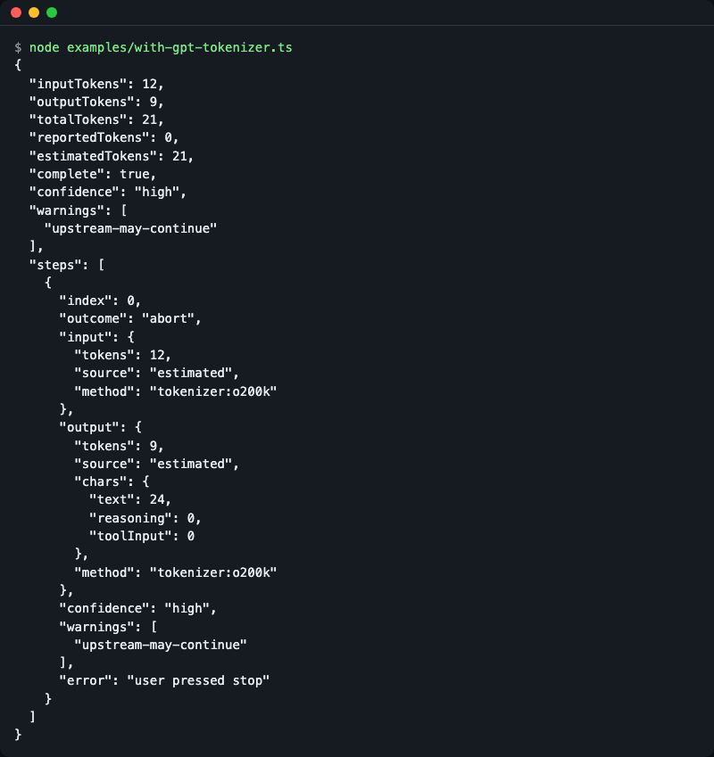
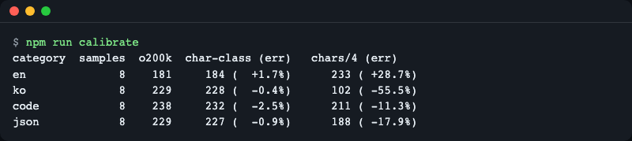

# abort-usage

**English** | [한국어](README.ko.md)

Token usage middleware for the [Vercel AI SDK](https://ai-sdk.dev) (`ai` 7) that still gives you input and output token counts when a `streamText` call is stopped by the user, cut off, or fails, and labels every number as `reported` by the provider or `estimated` by this library. Add it with `wrapLanguageModel`, then read `tracker.summary()` for billing, quotas or cost dashboards.



*The demo (practice mode, mock provider): for a stopped or failed stream the SDK hands you nothing, abort-usage hands you a labelled number.*

## The problem

`streamText` only reports full usage when a request ends normally. What you get for the four ways a stream can end (checked with `ai` 7.0.183 and a mock provider; see the table above):

| Ending | What the AI SDK gives you |
|---|---|
| Complete | `onFinish` with `totalUsage` (the provider's numbers) |
| User stop (`abortSignal`) | `onAbort` with the *finished* steps only. A step that was running has no usage, so the total is 0 |
| Provider error | `onError`, then `onFinish` whose `totalUsage` fields are `undefined` |
| Multi-step stop | `onAbort` with the finished steps only (the stopped step is missing) |

Code like `usage.inputTokens ?? 0` therefore bills a stopped or failed request as 0 tokens, even though the provider may have generated and charged for much more. See [vercel/ai#7628](https://github.com/vercel/ai/issues/7628). abort-usage counts what passed through the stream and fills the gap with a labelled estimate.

## Install

```bash
npm install github:LeeGyeongPil/abort-usage
```

- Node.js 22 or newer. `ai` 7 (`>=7.0.0 <8`) is a peer dependency; there are no other runtime dependencies.
- To run the demo and examples from a clone you need Node 22.18 or newer (they rely on Node running `.ts` files directly):

```bash
git clone https://github.com/LeeGyeongPil/abort-usage && cd abort-usage
npm install
npm run demo
```

`npm install` from a clone also builds `dist/` (the `prepare` script). Installing from GitHub can print an npm warning about running `prepare`; it is expected and harmless.

If you have no Node yet: `brew install node` (macOS) or [nodejs.org](https://nodejs.org/). On a minimal Linux image you also need `git` and `ca-certificates`.

## Quick start

```ts
import { streamText } from 'ai';
import { createUsageTracker } from 'abort-usage';

const tracker = createUsageTracker();        // one tracker per request
const model = tracker.wrap(yourModel);       // yourModel: any AI SDK 7 language model

const record = () => ledger.add(tracker.summary());   // your own billing / quota code

const result = streamText({
  model, prompt, abortSignal,
  onFinish: record,                          // complete, and provider error (onError comes first)
  onAbort: record,                           // user stop
});
```

Read the total in **both** `onFinish` and `onAbort`, and nowhere else: each request ends in exactly one of them (see [Billing](#billing-read-the-total-once)).

The complete runnable file (with a mock provider instead of `yourModel`, so no API key is needed) is [`examples/quickstart.ts`](examples/quickstart.ts). Run it from a clone:

```bash
node examples/quickstart.ts
```

```text
onAbort records: 12 tokens
{
  inputTokens: 6,
  outputTokens: 6,
  reportedTokens: 0,
  estimatedTokens: 12
}
abort estimated low [ 'heuristic-estimate', 'upstream-may-continue' ]
```



*The quick start: the stream was aborted after five chunks, and the tokens are counted anyway. Both numbers are `estimated`, with `low` confidence.*

## Billing: read the total once

Which callback fires depends on how the request ends. Measured with `ai` 7.0.183:

| Ending | Callbacks, in order | Where to read `tracker.summary()` |
|---|---|---|
| Complete | `onFinish` | `onFinish` |
| User stop | `onAbort` | `onAbort` |
| Provider error | `onError`, then `onFinish` | `onFinish` (not `onError`, or the request is billed twice) |
| Multi-step stop | `onAbort` | `onAbort` |

So `onFinish` plus `onAbort` cover every ending exactly once. If you share one model object between many requests, skip the tracker and use `usageMiddleware({ onStep })` (Example 2): it fires once per ended step regardless of callbacks. This order is SDK behaviour and may change in other `ai` versions; the callback-order tests in `npm test` (`test/finish.test.ts`, `test/abort.test.ts`, `test/error.test.ts`, `test/multistep.test.ts`) check all four endings against the installed version.

## Core concepts



1. **Step.** One model call. A plain answer is one step; an agent that calls a tool and answers again is two.
2. **Closed exactly once.** The middleware passes every chunk through unchanged and closes the step on whatever happens first: the finish chunk, an error chunk, the request's `AbortSignal`, the consumer cancelling the stream, or the stream ending without a finish chunk.
3. **Reported vs estimated.** If the provider sent usage, you get it with `source: 'reported'`. If not, the library estimates from what it saw: the prompt (plus tool definitions) for input, the text, reasoning and tool-argument deltas that arrived for output. Those numbers carry `source: 'estimated'`, a `method`, a `confidence` (`exact`, `high` with an injected tokenizer, `low` with the default heuristic) and warning codes.
4. **Totals keep the two apart.** `summary()` has `reportedTokens` and `estimatedTokens`, so a dashboard can show how much of a bill is a guess.

Mixed example (the demo's `multistep-abort` row): step 1 finished and the provider said 30 in / 12 out; the user stopped step 2. The total is 147 tokens = 42 reported + 105 estimated.

## API

| Name | What it does | Main arguments | Returns |
|---|---|---|---|
| `usageMiddleware(options)` | AI SDK `LanguageModelMiddleware` (`wrapStream`). Safe to share between requests. | `onStep(step)` called once per model call; `estimator`; `warnUpstreamMayContinue` (default `true`); `onCallbackError` (default `console.warn`) | `LanguageModelMiddleware` |
| `createUsageTracker(options?)` | Per-request helper that collects steps. | same options as above, `onStep` optional | `UsageTracker`: `middleware`, `wrap(model)`, `steps` (ended steps), `summary()` |
| `summarize(steps)` | Sums `StepUsage[]` collected through `onStep`. | `StepUsage[]` | `UsageSummary` |
| `charClassEstimator(coefficients?)` | Default estimator: tokens per character by class (Hangul, CJK, word, space, symbol). No dependencies. | partial `CharClassCoefficients` | `TokenEstimator` |
| `tokenizerEstimator(count, name?)` | Wraps your tokenizer function; results get `confidence: 'high'`. | `count(text) => number`, a name | `TokenEstimator` |
| `toLanguageModelUsage(usage)` | Converts a summary or one step into the SDK's `LanguageModelUsage` shape. Estimated numbers are included as they are. | `UsageSummary` or `StepUsage` | `LanguageModelUsage` |

Types: `StepUsage`, `UsageSummary`, `StepOutcome` (`finish`, `abort`, `error`, `cancel`, `ended-without-finish`, `open`), `UsageSource`, `Confidence`, `UsageWarning`, `TokenEstimator`, `CharClassCoefficients`, `UsageMiddlewareOptions`, `UsageTracker`, `TrackerOptions`.

`summary()` also includes steps that are still running, as `outcome: 'open'` with an estimate, so it never returns zero just because of event order. `summary().complete` is `false` while any step is open.

Warning codes (stable strings): `upstream-may-continue`, `heuristic-estimate`, `reported-usage-missing`, `non-text-input-not-counted`, `reasoning-not-streamed`.

If `onStep` throws, the stream is not affected; the error goes to `onCallbackError`.

## Examples

All examples use a mock provider and need no API key. Run them from a clone.

**1. Quick start** (reads the total in `onFinish` and `onAbort`) — see above, [`examples/quickstart.ts`](examples/quickstart.ts).

**2. Bill every step of a shared model.** For one model object shared by many requests, use `usageMiddleware({ onStep })` and write each step to your ledger. [`examples/billing.ts`](examples/billing.ts):

```bash
node examples/billing.ts
```

```text
[ 'abort: 6 in (estimated) / 3 out (estimated)' ]
{
  inputTokens: 6,
  inputTokenDetails: {
    noCacheTokens: undefined,
    cacheReadTokens: undefined,
    cacheWriteTokens: undefined
  },
  outputTokens: 3,
  outputTokenDetails: { textTokens: undefined, reasoningTokens: undefined },
  totalTokens: 9
}
```

`toLanguageModelUsage()` gives the SDK's usage shape, which you can hand to a cost calculator of your choice. Check `summary.estimatedTokens` first if estimated numbers must not be charged.

**3. A real tokenizer for higher confidence.** [`examples/with-gpt-tokenizer.ts`](examples/with-gpt-tokenizer.ts) injects [`gpt-tokenizer`](https://www.npmjs.com/package/gpt-tokenizer) (`o200k_base`) with `tokenizerEstimator((text) => encode(text).length, 'o200k')`:

`gpt-tokenizer` is a dev dependency, so it is installed by `npm install` in a clone (in your own project: `npm install gpt-tokenizer`). The example imports `../src`, so run it from a clone.

```bash
node examples/with-gpt-tokenizer.ts
```

The record now says `"method": "tokenizer:o200k"` and `"confidence": "high"`; the result is shown as a step record (`source`, `method`, `confidence`, `warnings`, characters received):



*One summary: every number comes with its source, method and warnings.*

**4. The demo.** `npm run demo` runs four endings (complete, user stop, provider error, multi-step stop) and prints the comparison table shown at the top. `npm run demo -- --json` prints the records; `--lang en|ko` switches the language (order: `--lang`, then `ABORT_USAGE_LANG`, then `LC_ALL`, `LC_MESSAGES`, `LANG`; anything that is not Korean falls back to English).

The demo is a practice mode: only the provider is a mock model; `streamText`, `AbortController` and the SDK callbacks are the real ones. With a real provider, timings and numbers will differ.

## How accurate are the estimates?

Be careful here. Read this before charging anyone.

- Estimates are a **lower bound**: when the client stops, the provider may keep generating and billing. Every non-finished step carries `upstream-may-continue` for this reason.
- The default estimator is a character-class heuristic. Its coefficients were fitted on a small corpus of 32 hand-written samples (8 each of English, Korean, code, JSON) against `o200k_base`. The table below is therefore an **in-sample fit** and looks better than real-world error will; the sample is small and the Korean row is the only non-Latin text. Expect roughly ±25% on similar text, more on text unlike the sample.
- **CJK ideographs and kana use a coefficient (0.9) with no samples behind it.** It is unvalidated. Inject a tokenizer if you serve Chinese or Japanese.
- The tokenizer differs by provider. `o200k_base` is an OpenAI encoding; other providers will count the same text differently.
- Images and files in the prompt are not counted (`non-text-input-not-counted`). Reasoning that a provider does not stream cannot be counted either.
- Input is estimated from the prompt serialized as text and does not include a provider's hidden chat-template tokens exactly.

```bash
npm run calibrate
```

```text
category  samples  o200k  char-class (err)   chars/4 (err)
en              8    181     184 (  +1.7%)      233 ( +28.7%)
ko              8    229     228 (  -0.4%)      102 ( -55.5%)
code            8    238     232 (  -2.5%)      211 ( -11.3%)
json            8    229     227 (  -0.9%)      188 ( -17.9%)
```



*Error of the default estimator vs a plain chars/4 rule, against o200k_base, on the fitting corpus itself.*

## Limits

- `streamText` only. `generateText` (`wrapGenerate`) is not covered yet.
- Written for `ai` 7 (middleware spec `v4`). It is not tested with `ai` 6.
- If the consumer simply stops reading without passing an `abortSignal`, whether the SDK propagates the cancel to the middleware depends on the SDK; otherwise the step stays `open` in `summary()`. Pass the `abortSignal` to `streamText`.
- Provider usage that arrives before the stream ends (for example an early input count) is not read yet, so input of a stopped step is always `estimated`.
- Use one tracker per request. A tracker reused across requests mixes their totals.

## When to use it

- Good fit: you bill, limit or chart tokens per user and your numbers come from `onFinish`, so stopped and failed requests show up as zero.
- Other tools fit better when: you need a provider-side invoice-exact number (read the provider's usage dashboard or API), you need to count tokens of a request before sending it (use a tokenizer such as [gpt-tokenizer](https://www.npmjs.com/package/gpt-tokenizer)), or you only need to convert already-known usage to money (a pricing library such as [tokenlens](https://www.npmjs.com/package/tokenlens)).

## Troubleshooting

| Symptom | Cause | Fix |
|---|---|---|
| `summary()` inside `onAbort` shows `outcome: 'open'` | Event order differs in your `ai` version | The number is still an estimate; read it after the stream ends. Please open an issue with your `ai` version. |
| All outputs are tiny after a stop | The stream was cut early, so only a few chunks arrived | Expected: only received text is counted. |
| `node examples/quickstart.ts` fails to start | Node older than 22.18 cannot run `.ts` files directly | Upgrade Node. The library itself works on Node 22. |
| An example cannot import `abort-usage` | `dist/` was not built | Run `npm install` (it builds `dist/`) or `npm run build`. |
| Totals mix two requests | One tracker used for several requests | Create a tracker per request or use `usageMiddleware({ onStep })`. |

## Versions and compatibility

- Follows [Semantic Versioning](https://semver.org/). While 0.x, the API may change in a minor version; changes are listed in [CHANGELOG.md](CHANGELOG.md).
- Tested locally with `ai` 7.0.183, TypeScript 7.0.2 and Node 26. The CI workflow runs Node 22.18 and 24; results appear in the repository's Actions tab once published.

## Development

```bash
npm install
npm test          # type check + 32 tests, no API key
npm run build
```

## Learn more

- AI SDK, stopping streams: <https://ai-sdk.dev/docs/advanced/stopping-streams> (checked 2026-11-27)
- The request behind this library, usage missing on abort: <https://github.com/vercel/ai/issues/7628> (checked 2026-11-27)
- Why stop does not always stop the provider: <https://ably.com/vercel/why-vercel-ai-sdk-stop-doesnt-cancel-the-stream> (checked 2026-11-27)

## License

MIT.
